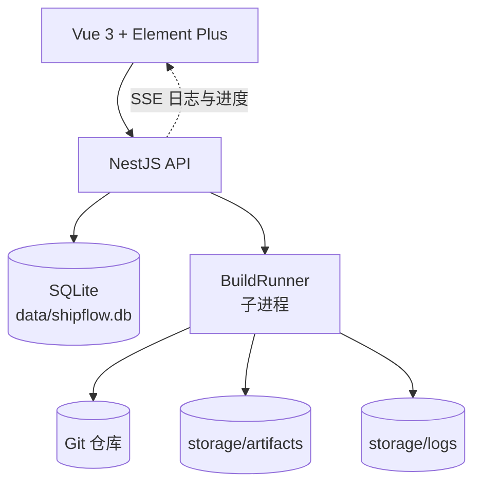
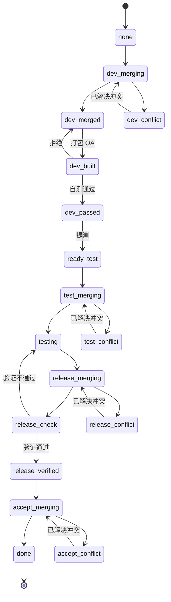

# ShipFlow 技术方案

> 状态：方案讨论稿  
> 关联原型：[代码合并与打包平台-原型.html](./代码合并与打包平台-原型.html)

## 1. 背景与目标

ShipFlow 是一套内部研发交付平台，把「应用 → 需求 → 任务 → CI 流水 → 合并 → 打包 → 产物」串成一条可追踪的流水线。

一期要解决的核心问题：

- 开发、测试、产品按角色和级别看到不同菜单、执行不同动作
- 一个任务可以挂多条 CI 流水，例如 Flutter 任务同时打 Android APK 与 iOS IPA
- 每条流水独立完成 QA、UAT、Release、master 四个阶段的合并与打包
- 合并冲突时能生成临时分支，开发在本地解决后回到平台继续
- 打包机单机单 clone，构建串行执行，日志和产物可追踪

一期不做：Jenkins 接入、审批流、镜像构建、蓝绿发布、自动回滚、多构建机、SSO、K8s。

## 2. 技术选型

| 层 | 选型 | 说明 |
|---|---|---|
| 前端 | Vue 3 + TypeScript + Vite + Element Plus + Pinia + Vue Router + TanStack Query | 权限后台、密集表格与表单；用 Element Plus 变量覆盖成原型的蓝色风格 |
| 后端 | NestJS + class-validator + JWT + bcrypt + Swagger | 模块化清晰，适合按领域拆模块 |
| ORM | Prisma | 一期 SQLite，后续切 PostgreSQL 时查询层改动小 |
| 数据库 | SQLite 文件 `data/shipflow.db` | 不需要安装数据库服务，随项目生成 |
| 队列 | `builds` 表状态 + 单消费者 | 一期不引入 Redis；构建串行执行 |
| 进程执行 | execa + git CLI | 直接调用本机 git，行为与研发本地一致 |
| 产物匹配 | fast-glob | 按应用配置的 `artifactPattern` 匹配构建产物 |
| 实时日志 | SSE | 构建日志单向推送，比 WebSocket 简单 |
| 产物存储 | 本地 `storage/` | 后续可替换为 MinIO/S3 |
| 工程 | pnpm workspace | web、api、worker 与 shared 包统一管理 |

## 3. 总体架构



架构原则：

1. **控制面与执行面分离**：API 负责账号、权限、状态机和动作校验；构建执行放到独立子进程，避免阻塞请求。
2. **状态机服务端权威**：前端按钮只做展示，所有门禁在 API 层再校验一次。
3. **长任务异步化**：合并、打包都通过任务队列执行，HTTP 请求只负责创建任务。
4. **单机串行**：一期只有一个构建机，合并与打包不能并发。
5. **存储可迁移**：业务代码依赖仓储接口，不直接依赖 SQLite 或 Prisma。

## 4. 本地运行形态

一期目标是本地直接跑起来，不依赖外部服务：

```bash
pnpm install
pnpm db:init     # 生成 data/shipflow.db 并写入种子数据
pnpm dev         # 同时启动 web 与 api
```

- Web：`http://localhost:5173`
- API：`http://localhost:3000`
- 构建子进程由 API 在同一台机器上拉起
- 不需要安装 PostgreSQL、Redis、Jenkins

目录约定：

```text
data/shipflow.db                         # 运行时数据库，git 忽略
prisma/schema.prisma                     # 模型定义
prisma/migrations/**/migration.sql       # 建表 SQL
prisma/init.sql                          # 演示用合并版初始化 SQL
storage/artifacts/<appId>/<buildId>/     # 产物
storage/logs/<appId>/<buildId>.log       # 每次构建的完整脚本日志
storage/tmp/                             # 产物中转、临时 worktree
workspace/<appId>/                       # git clone，可重建
```

### 4.1 关于 `.sql` 与 `.db`

SQLite 的运行时文件是 `.db` 或 `.sqlite`，`.sql` 只是建表或种子脚本，不能直接当作数据库运行。

因此交付方式分两种：

- **源码交付**：提交 `prisma/migrations/**/migration.sql` 和 `prisma/init.sql`，首次运行 `pnpm db:init` 生成 `data/shipflow.db`
- **演示打包**：构建时生成好带种子数据的 `data/shipflow.db`，随演示包一起分发，开箱即用

运行中的 `.db` 不提交 git，避免二进制冲突和文件锁问题。

## 5. 数据存储设计

### 5.1 存储分层

| 层 | 存什么 | 是否事实来源 |
|---|---|---|
| SQLite | 账号、权限、需求、任务、流水、合并、冲突、构建、产物元数据、事件 | 是 |
| 本地文件系统 | git clone、产物文件、完整构建日志 | 产物和日志是；clone 可重建 |
| 内存 | 当前构建进程、SSE 订阅、串行锁 | 否 |

一期不引入 Redis。构建队列直接使用 `builds` 表的状态，单消费者按创建时间取任务，构建串行执行。

### 5.2 数据表

| 表 | 关键字段 | 说明 |
|---|---|---|
| `users` | id、account、password_hash、name、role、level、team、active、created_at | account 唯一；admin 不设 level |
| `permission_defs` | key、label、group_key、menu、hash、admin_only、sort | 权限定义，seed 自原型 perm-config |
| `role_permissions` | role、level、permission_key | 复合主键；admin 固定全量，不落表 |
| `apps` | id、name、platform、code、repo、default_branch、build_script、artifact_type、artifact_pattern、branches_json、machine、stack、created_at | `branches_json` 存 QA/UAT/Release/master 映射 |
| `requirements` | id、code、title、description、dev_owner_id、qa_owner_id、pm_owner_id、priority、due_at、created_at | code 唯一 |
| `tasks` | id、req_id、title、description、owner_id、priority、start_at、due_at、created_at | 不存状态，由流水聚合 |
| `pipelines` | id、task_id、app_id、name、branch、status、created_at、updated_at | status 是权威状态 |
| `pipeline_merges` | id、pipeline_id、stage、from_branch、to_branch、sha、commits、operator_id、merged_at | 每次合并一行，保留历史 |
| `pipeline_conflicts` | id、pipeline_id、stage、temp_branch、created_at、resolved_at、resolved_by | 同一阶段可能多次冲突 |
| `pipeline_conflict_files` | id、conflict_id、path | 冲突文件列表，避免把数组塞 JSON |
| `pipeline_events` | id、pipeline_id、type、from_status、to_status、payload_json、actor_id、created_at | 追加型审计，不更新 |
| `builds` | id、pipeline_id、stage、merge_sha、status、active_key、started_at、finished_at、exit_code、log_path、log_size_bytes、log_tail、log_truncated、log_deleted_at、error_message、triggered_by、created_at | 同时充当构建队列表；日志文件路径与尾部快照都在这里 |
| `artifacts` | id、build_id、name、type、size_bytes、sha256、relative_path、created_at | 文件在磁盘，库里只存元数据 |

常用索引：

- `users.account` 唯一
- `requirements.code` 唯一
- `tasks.req_id`
- `pipelines.task_id`、`pipelines(app_id, status)`
- `builds(pipeline_id, stage, created_at)`
- `builds.active_key` 唯一
- `pipeline_events(pipeline_id, created_at)`

### 5.3 关键约束

1. **任务状态不落库**。任务状态由流水阶段和当前时间聚合，规则与原型一致：已结束 > 超时 > 四段进展 > 未开始。
2. **合并、冲突拆表**。原型为了轻量把它们放在 pipeline JSON 里，真实系统需要按阶段查询和审计，拆表更稳。
3. **`apps.branches_json` 继续用 JSON**。这是小配置，读取时整体取出，不需要按字段查询。
4. **同一流水同一阶段只允许一个进行中构建**。用可空唯一列 `active_key` 实现：
   - `queued` / `running` 时写入 `${pipelineId}:${stage}`
   - 结束、失败、取消后置为 `NULL`
   - SQLite 与 PostgreSQL 都允许多个 `NULL`，切换数据库不用改规则
5. **构建队列与业务状态双写**。API 先插入 `queued` 的 build，再由消费者领取；构建状态以 DB 为准。
6. **流水事件只追加**。状态每次变化写一条 `pipeline_events`，用于审计和问题排查。

### 5.4 可移植 Schema 约定

为了保证未来切换 PostgreSQL 时不用重写业务，schema 遵守以下约定：

- ID 使用应用生成的 UUID 字符串，不用自增主键
- 状态、角色、平台等枚举使用 `String` + TypeScript 联合类型，不用数据库 enum
- JSON 先按 `TEXT` 存，仓储层做序列化；切 PostgreSQL 后可以保持 TEXT，也可以再迁 `jsonb`
- 数组不落 JSON，拆子表
- 时间统一用 UTC，领域层使用 `Date`，由 ORM 映射
- 布尔值交给 ORM 映射，不在业务代码里写 `0/1`
- 不使用 SQLite 特有的 `AUTOINCREMENT`、`INSERT OR REPLACE`、触发器、部分索引
- 搜索统一走 `LOWER()` 或归一化字段，避免大小写差异
- 事务统一通过 `UnitOfWork`，不让业务代码直接写数据库方言
- 避免在仓储层使用 `$queryRaw`；确需使用时必须单独封装并有 PostgreSQL 版本

### 5.5 初始化与演示打包

初始化流程：

1. `prisma/schema.prisma` 是模型唯一来源
2. `prisma migrate dev` 生成 `prisma/migrations/**/migration.sql`
3. `prisma/seed.ts` 从原型数据导入账号、权限、示例应用、需求、任务、流水
4. `pnpm db:init` 执行迁移和 seed，生成 `data/shipflow.db`
5. `prisma/init.sql` 由迁移 SQL 与种子 SQL 合并生成，供演示或手工初始化使用

演示打包：

- 打包前执行一次 `pnpm db:init`
- 把 `data/shipflow.db` 一并放进演示产物
- 首次启动检测数据库是否存在，不存在则自动初始化
- `data/shipflow.db` 加入 `.gitignore`

### 5.6 文件存储

产物：

```text
storage/tmp/<buildId>/                    # 构建产物先写这里
storage/artifacts/<appId>/<buildId>/      # 成功后原子 rename 到这里
```

- 构建成功后计算 `sha256` 和文件大小，再插入 `artifacts`
- 下载接口只允许读取 `storage/artifacts` 下的路径，防止路径穿越
- 文件名为空或非法时直接拒绝入库

日志：

- 每次构建创建独立日志文件：`storage/logs/<appId>/<buildId>.log`
- 文件首部写入 buildId、流水、阶段、构建脚本、工作目录、`merge_sha`、开始时间
- 子进程 stdout/stderr 按行追加，每行带时间戳与 `[stdout]` / `[stderr]` 标记
- 构建结束追加退出码、耗时、产物路径；构建失败也保留完整日志
- `builds.log_path` 指向文件，`builds.log_size_bytes` 记录大小
- `builds.log_tail` 保存最后 200 行；即使文件被清理，构建记录里仍能看到失败上下文
- 历史日志通过 `GET /api/builds/:id/logs` 查看或下载，不依赖 SSE
- 默认保留全部日志；需要清理时按 `LOG_RETENTION_DAYS` 删除文件并写入 `log_deleted_at`，保留 `log_tail`
- 单次日志超过上限（如 50MB）时截断并标记 `log_truncated`，避免磁盘被打满
- 日志接口需要登录鉴权，并做路径越界校验

Git 工作区：

- `workspace/<appId>` 每个应用一份 clone
- 同一时刻只允许一个任务操作，构建期间禁止合并
- 工作区损坏时可以删除重建，不属于事实来源

### 5.7 迁移到 PostgreSQL

需要改：

| 项目 | 改动 |
|---|---|
| Prisma provider | `sqlite` → `postgresql` |
| 连接配置 | `DATABASE_URL` 指向 PostgreSQL |
| 迁移 | 重新生成一套 PostgreSQL migration |
| JSON 列 | 可选升级为 `jsonb` |
| 多 Worker | 领取任务改为 `FOR UPDATE SKIP LOCKED` |
| 数据迁移 | 写脚本从 SQLite 读取、按 ID 写入 PostgreSQL |

不需要改：

- 领域实体、值对象、状态机
- 用例、Controller、DTO
- 前端页面与接口
- 权限、流水、构建业务规则
- 仓储接口签名

建议现在就为仓储接口写契约测试，SQLite 跑一遍；接入 PostgreSQL 后同一套测试再跑一遍，快速发现方言差异。

## 6. 后端设计

### 6.1 分层与端口

```text
Controller
   ↓
Application Service / Use Case
   ↓
Domain（实体、状态机、纯业务规则）
   ↓
Ports（接口）
   ↑
Adapters（Prisma SQLite、Git CLI、Spawn Runner、本地存储、SSE）
```

端口清单：

| 端口 | 作用 | 一期实现 |
|---|---|---|
| `AccountRepository` | 账号读写 | Prisma SQLite |
| `PermissionRepository` | 权限定义与角色矩阵 | Prisma SQLite |
| `AppRepository` | 应用配置 | Prisma SQLite |
| `RequirementRepository` | 需求 | Prisma SQLite |
| `TaskRepository` | 任务 | Prisma SQLite |
| `PipelineRepository` | 流水、合并、冲突、事件 | Prisma SQLite |
| `BuildRepository` | 构建记录与队列 | Prisma SQLite |
| `ArtifactRepository` | 产物元数据 | Prisma SQLite |
| `UnitOfWork` | 事务边界 | Prisma `$transaction` |
| `JobQueue` | 构建任务领取与完成 | `builds` 表轮询 |
| `GitGateway` | fetch、merge、建临时分支、push | git CLI |
| `BuildRunner` | 执行构建脚本、回传日志 | execa 子进程 |
| `ArtifactStore` | 产物落盘与读取 | 本地文件系统 |
| `EventPublisher` | SSE 日志与状态事件 | Node EventEmitter |

领域层不引用 Prisma、不引用 NestJS，保证可以单独测试和替换存储。

### 6.2 NestJS 模块

- `AuthModule`：登录、JWT、密码校验
- `StaffModule`：人员管理
- `PermissionsModule`：权限定义、角色矩阵、守卫
- `RequirementsModule`
- `TasksModule`
- `AppsModule`
- `PipelinesModule`：状态机、合并、冲突
- `BuildsModule`：队列、构建、日志、产物
- `GitModule`：git CLI 封装
- `EventsModule`：SSE
- `PersistenceModule`：Prisma 与仓储绑定
- `RunnerModule`：构建消费者

### 6.3 依赖注入与组合根

仓储通过 token 注入，业务服务只依赖接口：

```ts
{ provide: PIPELINE_REPOSITORY, useClass: PrismaPipelineRepository }
```

未来切换 PostgreSQL 时，只替换 Composition Root 中的绑定：

```ts
{ provide: PIPELINE_REPOSITORY, useClass: PostgresPipelineRepository }
```

### 6.4 仓储契约测试

每个仓储定义一份契约测试，覆盖：

- 创建、按 ID 查询、按条件查询
- 更新与状态流转
- 唯一约束冲突
- 事务回滚
- 时间字段的读写一致性
- JSON 字段的序列化与反序列化

SQLite 实现先跑通；未来 PostgreSQL 实现复用同一套测试。

## 7. 核心流程

### 7.1 流水状态机



阶段与角色：

| 阶段 | 进行中 | 冲突 | 完成 | 操作角色 |
|---|---|---|---|---|
| QA | `dev_merging` | `dev_conflict` | `dev_merged` | 开发 |
| UAT | `test_merging` | `test_conflict` | `testing` | 测试 |
| Release | `release_merging` | `release_conflict` | `release_check` | 测试 |
| master | `accept_merging` | `accept_conflict` | `done` | 测试 |

状态机放在 `packages/shared`，前端用它渲染文案与按钮，后端用同一份 transition table 做权威校验。

### 7.2 硬门禁

1. **提测**：必须有成功的 QA 包，且开发已点「自测通过」
2. **合并 Release**：必须有成功的 UAT 包
3. **验收**：必须有成功的 Release 包
4. **包必须匹配最新合并**：`build.merge_sha` 必须等于该阶段最近一次 `pipeline_merges.sha`
5. **构建期间禁止合并**：有 `running` 构建时，合并请求直接返回 409

### 7.3 合并与冲突

正常合并：

1. `git fetch origin`
2. 检出目标分支
3. 合并 Feature 分支
4. 推送目标分支
5. 写入 `pipeline_merges` 与 `pipeline_events`
6. 更新流水状态

冲突处理：

1. 合并失败后执行 `git merge --abort`
2. 基于 Feature 分支创建临时分支 `temp/Conflict_<target>_feature/<slug>_<stamp>`
3. 推送临时分支到远程
4. 写入 `pipeline_conflicts` 与 `pipeline_conflict_files`
5. 流水状态改为对应阶段的冲突态
6. 用户在本地拉取临时分支、解决冲突、推送
7. 用户回到平台点「已解决冲突 · 合并」
8. 服务端 fetch 临时分支，合入目标分支，继续后续流程

所有 git 命令使用 execa 的数组参数形式，不拼接 shell 字符串，避免命令注入。

### 7.4 构建队列与串行

一期使用 `builds` 表作为队列：

- 创建构建：插入 `status = queued` 的记录，写入 `active_key`
- 消费者领取：按 `created_at` 取最早一条 `queued`，条件更新为 `running`
- 更新条件必须校验当前状态，受影响行数为 0 表示已被其他任务领取
- 构建结束：更新 `success` / `failed`，清空 `active_key`
- 单消费者 `concurrency = 1`，天然串行

合并与构建的互斥：

- 一期 API 与消费者在同一进程，使用进程内串行锁
- 构建进行中，合并接口返回 409
- 未来多进程部署时，改为数据库锁或 Redis 锁，接口不变

启动恢复：

- 服务启动时，查找 `status = running` 但当前进程没有对应子进程的构建
- 标记为 `failed`，清空 `active_key`
- 提示用户重新打包，避免流水卡死

### 7.5 日志与产物

日志生命周期：

1. 构建任务开始时创建 `storage/logs/<appId>/<buildId>.log`
2. 写入构建头部信息：构建脚本、工作目录、`merge_sha`、触发人、开始时间
3. 子进程 stdout/stderr 按行写入，带时间戳与流标记
4. 构建结束写入退出码、耗时、产物路径
5. 构建记录页始终可以「查看日志 / 下载日志」，不依赖 SSE
6. SSE 只负责构建中的实时追加；历史日志走普通 HTTP 文本响应

日志查看入口：

- 任务详情 → 构建记录：每条构建可查看、下载日志
- 流水详情 → 构建记录：查看当前与历史构建
- 打包产物列表：从产物进入所属构建的日志

日志与产物的实时推送：

- 构建子进程按行写入日志文件
- 同时通过 `EventPublisher` 推送给 SSE 订阅者
- 前端使用 `fetch-event-source`，在请求头中携带 JWT
- 构建成功后先写临时目录，再原子 rename 到正式产物目录
- 产物写入成功后插入 `artifacts`；插入失败则清理文件
- 下载接口校验路径必须位于 `storage/artifacts` 下

## 8. 权限设计

权限模型：

- `permission_defs`：权限项定义，含 `menu`、`hash`、`admin_only`
- `role_permissions`：角色 × 级别的权限集合
- `users.role` / `users.level`：账号所属角色与级别
- `admin`：固定拥有全部权限，不读取 `role_permissions`

校验规则：

- 菜单可见性：`level → menu permission`
- 动作可执行性：`role → action permission`
- 前端路由守卫只负责隐藏菜单与页面
- 后端 `@RequirePermission('merge_qa')` 做最终校验
- 操作类权限与菜单权限使用同一张定义表，新增权限只加数据，不改代码

初始化：

- 从原型 `perm-config` JSON 导入权限定义
- 从原型 `DEFAULT_PERMS` 导入角色默认权限
- 从原型 `ACCOUNTS` 导入示例账号，初始密码统一，首次登录可强制修改

## 9. API 草案

| 方法 | 路径 | 说明 |
|---|---|---|
| POST | `/api/auth/login` | 账号密码登录，返回 JWT |
| GET | `/api/me` | 当前账号、角色、级别、菜单与动作权限 |
| POST | `/api/auth/logout` | 退出登录 |
| GET | `/api/my-tasks` | 首页「我的任务」 |
| GET/POST/PUT/DELETE | `/api/requirements` | 需求管理 |
| GET/POST/PUT/DELETE | `/api/tasks` | 任务管理 |
| GET/POST/PUT/DELETE | `/api/apps` | 应用配置 |
| POST | `/api/tasks/:id/pipelines` | 创建 CI 流水 |
| POST | `/api/pipelines/:id/merge` | 执行指定阶段合并 |
| POST | `/api/pipelines/:id/resolve` | 确认冲突已解决并继续合并 |
| POST | `/api/pipelines/:id/qa-verdict` | 自测通过或拒绝 |
| POST | `/api/pipelines/:id/test` | 提测 |
| POST | `/api/pipelines/:id/build` | 触发构建 |
| POST | `/api/pipelines/:id/verify` | Release 验证 |
| POST | `/api/pipelines/:id/accept` | 合回 master |
| GET | `/api/builds/:id` | 构建详情 |
| GET | `/api/builds/:id/logs` | 历史日志文本，支持 `?download=1` |
| GET | `/api/builds/:id/logs/stream` | SSE 实时日志 |
| GET | `/api/artifacts` | 产物列表 |
| GET | `/api/artifacts/:id/download` | 下载产物 |
| GET/PUT | `/api/roles/perms` | 读取或保存角色权限，仅管理员 |
| GET/POST/PUT | `/api/staff` | 人员管理，仅管理员 |
| GET | `/api/health` | 健康检查 |

## 10. 前端设计

页面与原型对应：

- `/login`：账号登录
- `/home`：我的任务
- `/board`：任务看板
- `/reqs`、`/reqs/:id`：需求列表与详情
- `/apps`：应用配置
- `/artifacts`：打包产物
- `/roles`：角色权限，仅管理员
- `/staff`：人员管理，仅管理员
- `/spec`：需求说明
- 任务详情：抽屉或独立路由，包含概览、CI 流水、提交记录、构建记录
- 构建记录：每条构建提供「查看日志」「下载日志」，构建中自动切换到 SSE 实时输出

状态管理：

- Pinia：登录态、当前用户、菜单权限、UI 状态
- TanStack Query：服务端数据、缓存、失效
- Axios：统一封装 token、错误提示、401 跳转
- SSE：构建日志使用 `fetch-event-source`，避免 EventSource 不能带请求头的问题

样式：

- Element Plus 组件为主
- 通过 CSS 变量覆盖主色、圆角、字号、间距，贴近原型
- 复杂交互（抽屉、弹窗、冲突指引）沿用原型的结构

## 11. 工程结构

```text
shipflow/
├─ apps/
│  ├─ web/                 # Vue 3 + Vite + Element Plus
│  │  ├─ src/
│  │  │  ├─ api/
│  │  │  ├─ components/
│  │  │  ├─ layouts/
│  │  │  ├─ router/
│  │  │  ├─ stores/
│  │  │  ├─ views/
│  │  │  └─ styles/
│  │  └─ vite.config.ts
│  ├─ api/                 # NestJS HTTP
│  │  └─ src/
│  │     ├─ domain/
│  │     ├─ application/
│  │     ├─ infrastructure/
│  │     └─ interfaces/
│  └─ worker/              # 可选：独立消费者，一期可并入 api
├─ packages/
│  └─ shared/              # 状态机、DTO、权限常量、类型
├─ prisma/
│  ├─ schema.prisma
│  ├─ migrations/
│  ├─ init.sql
│  └─ seed.ts
├─ data/                   # SQLite 文件，git 忽略
├─ storage/                # 产物、日志、临时文件
├─ workspace/              # git clone
├─ docs/
└─ package.json
```

一期建议把消费者放在 `apps/api` 内运行，减少进程间通信；等需要多构建机时再拆出 `apps/worker`。

## 12. 风险与注意事项

1. **SQLite 单写者**：开启 WAL 与 `busy_timeout`，一期保持单进程写入；不要同时起多个 Worker 写库。
2. **构建机工具链**：iOS 构建依赖 macOS + Xcode，Android 依赖 SDK；构建脚本执行失败要给出明确日志。
3. **Git 凭据**：使用本机 SSH agent 或 deploy key，不把私钥写进数据库。
4. **构建脚本是可信输入**：`buildScript` 等同于执行任意命令，只有管理员能修改应用配置。
5. **路径安全**：产物下载、日志读取必须做路径规范化和越界校验。
6. **日志增长**：单次构建日志按大小截断，历史日志按保留天数清理；清理后至少保留 `log_tail`，保证失败上下文可查。
7. **演示数据库**：`data/shipflow.db` 不提交 git；演示包中携带的数据库要注明是种子数据。
8. **迁移风险**：切 PostgreSQL 前先跑仓储契约测试和数据迁移演练，不要直接在生产库上试。

## 13. 实施顺序

1. 搭建 pnpm workspace、`apps/web`、`apps/api`、`packages/shared`
2. 完成 Prisma schema、`migration.sql`、`init.sql`、seed
3. 定义仓储接口与 SQLite 实现，补契约测试
4. 实现登录、账号、角色级别、菜单与动作权限
5. 实现应用、需求、任务 CRUD
6. 实现流水状态机、合并、冲突临时分支
7. 实现构建队列、子进程执行、SSE 日志、产物入库
8. 迁移原型页面到 Vue 3 + Element Plus
9. 完成演示打包：带种子数据的 `shipflow.db` 与一键启动脚本

## 14. 关键决策记录

| 决策 | 选择 | 原因 |
|---|---|---|
| 数据库 | 一期 SQLite，未来 PostgreSQL | 演示零安装；仓储抽象保证可迁移 |
| ORM | Prisma | 迁移生成 SQL；切 provider 后查询代码改动小 |
| 队列 | `builds` 表 + 单消费者 | 一期单构建机，不需要 Redis |
| 实时日志 | SSE | 单向推送，实现简单 |
| 状态机 | 服务端权威 + 共享常量 | 前端只展示，避免绕过门禁 |
| 合并冲突 | 临时分支 + 本地解决 | 与研发现有 Git 习惯一致 |
| 产物存储 | 本地文件 | 一期简单；后续换 MinIO/S3 |
| 前端 | Vue 3 + Element Plus | 团队选型，后台组件覆盖完整 |
| 后端 | NestJS | 模块化清晰，TypeScript 全栈 |
